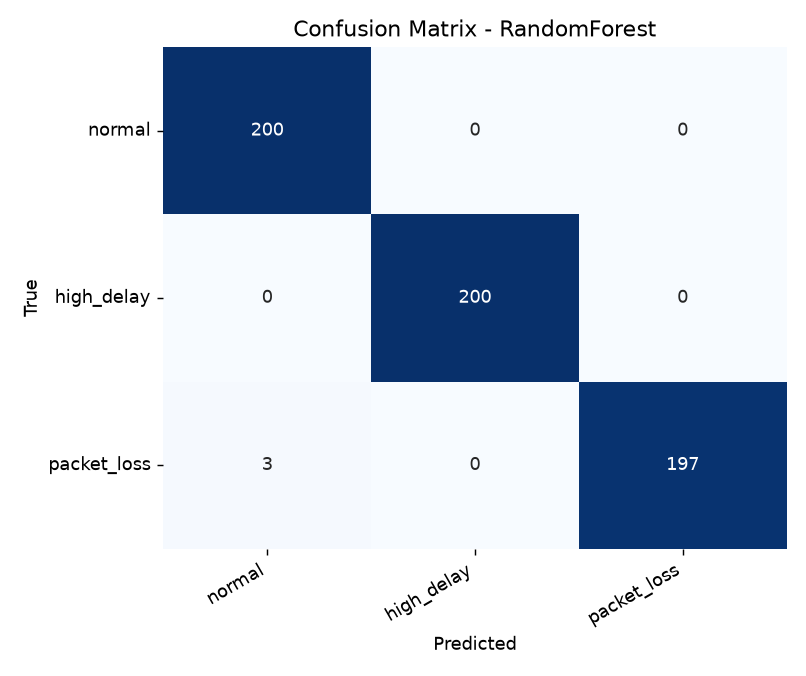
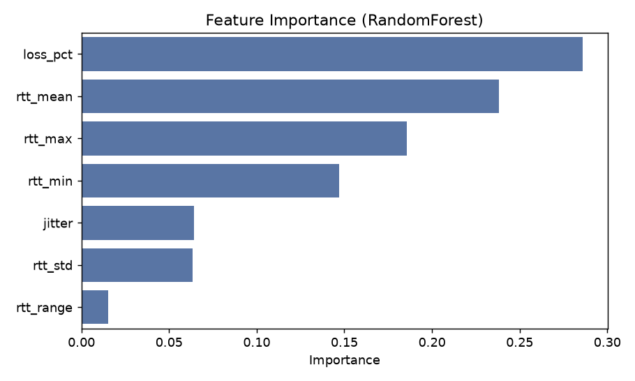

# GNS3 기반 네트워크 장애 유형 자동 분류

GNS3 가상 네트워크의 코어 링크에 패킷 필터로 장애를 주입하고, VPCS에서 ping을 쳐서 얻은 RTT·손실 값을 피처로 만들어 머신러닝(Random Forest, MLP)으로 장애 유형을 분류하는 프로젝트입니다. (충북대 정보통신공학 캡스톤)

분류하는 장애는 **정상 / 높은지연 / 패킷손실** 3종입니다.

## 결과

5-fold 교차검증 기준 (실측 88개를 증강해 600개, 클래스당 200개)

| 모델 | Accuracy | macro-F1 |
|---|---|---|
| Random Forest | 99.5% | 99.5% |
| MLP | 99.2% | 99.2% |




피처 중요도는 `loss_pct`(0.29), `rtt_mean`(0.24) 순으로 높았습니다. 패킷손실은 손실률로, 높은지연은 RTT로 구분된다는 뜻입니다.

실시간 데모(`demo.py`)에서도 3종 모두 맞게 분류했습니다. (정상 100%, 높은지연 96%, 패킷손실 80%)

## 토폴로지

```
PC1 ── PE1 ── P1 ──[Switch1]── P2 ── PE2 ── PC2
                 ↑
          필터를 거는 링크 (P1–Switch1)
```

라우터 4대(Cisco c7200)는 OSPF로 연결되어 있고, 측정은 PC1에서 PC2로 ping을 보내는 방식입니다. 장애는 라우터 설정이 아니라 GNS3 REST API로 링크에 패킷 필터를 걸어서 만듭니다.
P1–P2를 직접 연결하면 uBridge가 불안정해서 필터가 잘 안 먹었고, 사이에 스위치를 하나 넣으니 안정적으로 동작했습니다.

## 장애 필터

| 클래스 | filters |
|---|---|
| normal | `{}` |
| high_delay | `{"delay": [80, 10]}` |
| packet_loss | `{"packet_loss": [15]}` |

샘플마다 수치를 ±15% 흔들어 다양성을 줍니다. 패킷손실은 필터값이 15%여도 왕복에 양방향으로 적용돼서 실측 손실률은 30~40% 정도로 나옵니다.

## 피처 (ping 1회 = 30패킷 = 벡터 1개)

`loss_pct, rtt_mean, rtt_std, rtt_min, rtt_max, rtt_range, jitter`

## 파일 구성

| 파일 | 역할 |
|---|---|
| `config.py` | 클래스, 필터, GNS3 접속 정보, 경로 설정 |
| `features.py` | ping 출력 파싱 + 피처 계산 |
| `collect.py` | 필터 주입 + VPCS ping 수집 → `dataset_raw.csv` |
| `augment.py` | 클래스별 분포 기반 가우시안 증강 → `dataset.csv` |
| `train.py` | RF/MLP 학습, 5-fold CV, 그래프 저장 |
| `demo.py` | 필터 주입 → 측정 → 예측 |
| `synth_data.py` | GNS3 없이 파이프라인만 확인하는 합성 데이터 |

## 실행 방법

```bash
pip install -r requirements.txt
```

GNS3 서버에 비밀번호를 걸어둔 경우 환경변수로 넣어줍니다. (코드에 비밀번호를 적지 않았습니다)

```bash
# Windows cmd
set GNS3_PASSWORD=서버비밀번호
```

`config.py`에서 프로젝트 이름(`GNS3_PROJECT_NAME`), 코어 링크 양 끝 노드(`CORE_LINK_ENDPOINTS`), PC 이름과 IP를 본인 환경에 맞게 고칩니다.

```bash
python collect.py --inspect      # 노드/링크/콘솔 포트 확인
python collect.py --samples 30   # 실측 수집
python augment.py                # 증강
python train.py                  # 학습 + 평가
python demo.py --class high_delay
python collect.py --restore      # 링크 필터 초기화
```

GNS3 없이 코드만 돌려보려면 `python synth_data.py`로 합성 데이터를 만든 뒤 `augment.py`, `train.py`를 실행하면 됩니다.

## 제외한 장애와 이유

처음에는 링크다운, 혼잡까지 5종을 계획했지만 아래 이유로 뺐습니다.

- **링크다운**: 100% 손실이면 OSPF Hello까지 막혀 코어 라우팅이 끊깁니다. 손실률 100%라는 조건만으로 구분되기도 해서 ML이 필요 없습니다.
- **혼잡(지연+손실 동시)**: 두 필터를 같이 걸면 dynamips 큐가 불안정해져 수집 도중 전체 손실로 무너졌습니다.

## 환경

Python 3.12, scikit-learn, GNS3 2.2.x, Cisco c7200 IOS (dynamips)

## 한계 / 앞으로

- 실측이 88개라 증강에 의존합니다. 증강 데이터가 평가 fold에도 섞이므로, 실제 일반화 성능은 `demo.py`처럼 새로 측정한 값으로도 확인했습니다.
- 에뮬레이터라 기본 RTT가 120ms 정도로 높게 나옵니다.
- 혼잡·링크다운 같은 장애를 안정적으로 재현하는 방법은 추후 과제입니다.
